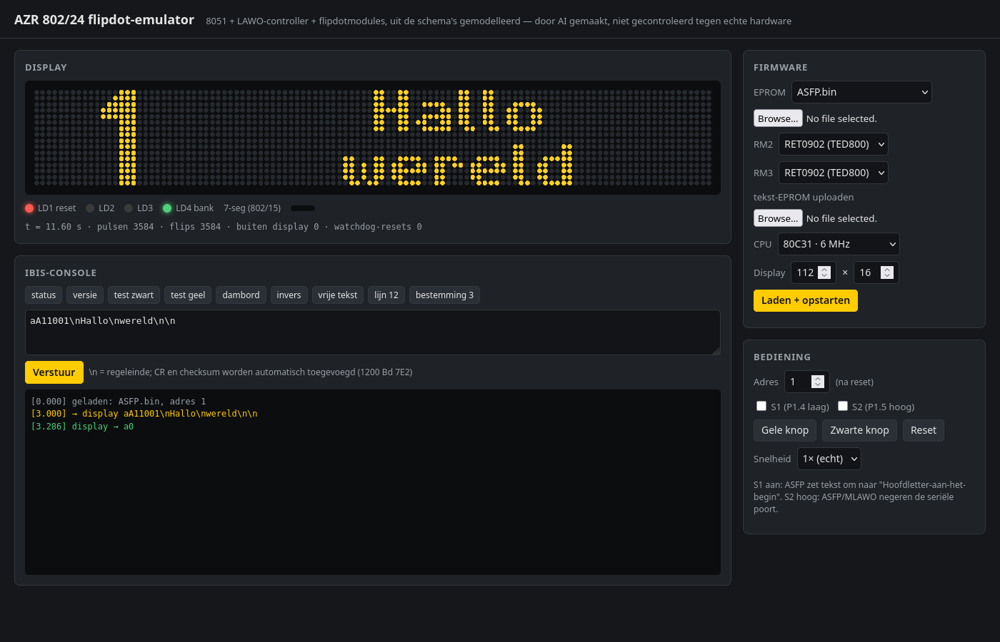

# LAWO flipdot – AZR 802/24 controller

> [!WARNING]
> **Alles in deze repository is gemaakt door een AI-tool (Claude Code). Dat geldt voor de analyse, de documentatie, de scripts, de disassembly en de decompilatie.
> Niets is door een mens gecontroleerd.** Fouten en verkeerde interpretaties zijn dus goed mogelijk. Controleer daarom zelf alles tegen de hardware en de originele bronnen voordat je erop vertrouwt.

Documentatie, firmware en reverse-engineering van de **LAWO / Mark IV (LLE) AZR 802/24** displaycontroller
voor flipdot-busfrontdisplays (IBIS-wagenbus, matrixmodules 28 × 13 / 28 × 16).

➡️ **Volledige analyse: [`docs/analyse.md`](docs/analyse.md)**

## In het kort

- **CPU**: 80C31 op 6 MHz, firmware in een 27C256, 4 KB werk-RAM plus twee gebankte sockets (RAM of tekst-EPROM).
- **I/O**: drie 74HC574-latches op XDATA 0x0000–0x0002 sturen rijdrivers (ULN2803/UDN2981) en de FP2800A-kolomdrivers op de modules.
- **Dots**: één dot per milliseconde, aangestuurd vanuit een timer-interrupt (puls via P3.4).
- **IBIS**: 1200 baud 7E2, telegram + CR + XOR-checksum. Ondersteund: `l` (lijn), `k` (koers), `z`/`zA` (bestemming), `a` (status), `aA` (vrije tekst), `aV` (versie), `aT` (testbeeld).

## Indeling

| Map | Inhoud |
|---|---|
| [`docs/`](docs/) | analyse-rapport, handleidingen en schema's ([`docs/manuals/`](docs/manuals/)), fontweergave |
| [`firmware/`](firmware/) | vijf firmware-images voor de controller ([toelichting](firmware/README.md)) |
| [`text-eproms/`](text-eproms/) | tekst-EPROMs: RET0902 (RET Rotterdam, TED800-stijl) en front.bin (`FORM`-stijl, 's-Hertogenbosch) |
| [`emulator/`](emulator/) | emulator van controller + display (8051, browser en commandline) om firmware te testen ([uitleg](emulator/README.md)) |
| [`tools/`](tools/) | `d51.py` (8051-disassembler) en de Ghidra-pipeline ([`tools/ghidra/`](tools/ghidra/)) |
| [`analysis/`](analysis/) | disassembly-listings en Ghidra-decompilatie (pseudo-C, functielijsten, xrefs) |
| [`third_party/`](third_party/) | IBIS Wagenbus-Utility van Stephan Schütt (freeware, [bronvermelding](third_party/README.md)) |

## Emulator

[`emulator/`](emulator/) voert de firmwares ongewijzigd uit op een gemodelleerde 8051 met de AZR 802/24 en de flipdotmodules eromheen. Je kunt er ook zelfgemaakte firmware mee testen. Er is geen npm-installatie nodig, alleen Node.js.

```sh
node emulator/serve.js                     # browser: http://localhost:8051/emulator/web/
node emulator/cli.js --rom firmware/ASFP.bin --script 'wait 3; send aA11001\nHallo\n\n; wait 8; show'
node emulator/test/run.js                  # tests
```



## Ghidra-analyse opnieuw draaien

Vereist Ghidra 12.x en JDK 25.

```sh
GHIDRA=~/tools/ghidra_12.2_PUBLIC tools/ghidra/run_ghidra.sh            # alle firmwares
GHIDRA=~/tools/ghidra_12.2_PUBLIC tools/ghidra/run_ghidra.sh ASFP.bin   # één firmware
```

Het Ghidra-project komt in `build/ghidra_project/` (niet in git); de tekstexport in `analysis/ghidra_export/`.

## Status

De analyse is deels zeker en deels afgeleid; in het rapport staat per bewering **[zeker]**, **[waarschijnlijk]** of **[vermoeden]**.
Plan voor later: een bitmap-telegram toevoegen aan de ASFP-firmware.
