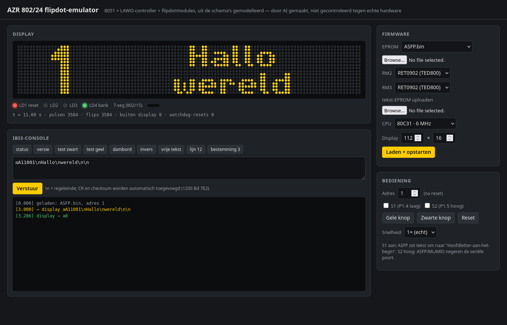

# AZR 802/24 emulator

> [!WARNING]
> Deze emulator is gemaakt door een AI-tool (Claude Code). Het hardwaremodel is afgeleid uit de schema's en
> gekalibreerd op de bestaande firmwares, maar **niet vergeleken met echte hardware**.

De emulator voert firmware voor de LAWO AZR 802/24 ongewijzigd uit: een instructie-nauwkeurige 8051 plus een
model van de controller en de flipdotmodules. Daarmee kun je de bestaande firmwares en zelfgemaakte of gepatchte
firmware testen zonder EPROM te branden.



## Gebruik

**Online, zonder installatie:** https://sebastius.github.io/lawo-flipdot/emulator/web/ (GitHub Pages)

Vereist Node.js 18 of nieuwer; er zijn geen npm-pakketten nodig.

**Browser**

```sh
node emulator/serve.js          # http://localhost:8051/emulator/web/
```

In de browser kun je:
- een firmware kiezen of je eigen `.bin` uploaden;
- een tekst-EPROM of RAM in RM2/RM3 zetten;
- het adres, S1/S2, de gele en zwarte knop en reset bedienen;
- telegrammen samenstellen met de **telegrambouwer**: kies het soort telegram (vrije tekst, bestemming, lijn, koers, testbeeld, status of versie) en vul de velden in. Je ziet het telegram en de checksum live. Umlauts en symbolen (loopmannetje, S-Bahn, U-Bahn) worden omgezet naar de tekens van de font, en je krijgt een waarschuwing bij te lange telegrammen. Handmatig typen kan ook. Met de *ASFP-bitmap*-firmwares (6 en 12 MHz; de klok wordt automatisch gekozen) zijn er ook pixels (klik op het display), een bitmap uit een afbeelding en "alles opnieuw";
- de LED's, het 7-segmentdisplay en de antwoorden van het display bekijken.

Met URL-parameters kun je meteen een situatie openen, bijvoorbeeld
`?rom=ASFP.bin&addr=1&prerun=3&send=aA11001%5CnHallo%5Cn%5Cn&after=6`.

**Commandline**

```sh
node emulator/cli.js --rom firmware/ASFP.bin --script 'wait 3; send aV1; wait 1; send aA11001\nHallo\nwereld\n\n; wait 8; show'
node emulator/cli.js --rom firmware/MLAWO_RET_RET60.PLM51_18-11-92.bin \
     --rm2 text-eproms/RET0902_14-10-2002_C256_05F55CD.bin --rm3 text-eproms/RET0902_14-10-2002_C256_05F55CD.bin \
     --script 'wait 3; send z003; send l012; wait 10; show; status'
```

Scriptstappen (gescheiden door `;`):

| Stap | Betekenis |
|---|---|
| `wait <s>` | tijd laten verstrijken |
| `send <telegram>` | IBIS-telegram versturen |
| `raw <tekst>` | losse tekens versturen |
| `press yellow\|black <s>` | knop ingedrukt houden |
| `set s1\|s2\|addr <v>` | schakelaar of adres wijzigen |
| `reset` | controller resetten |
| `show` | display als tekst tonen |
| `status` | LED's, 7-segment en tellers tonen |

Alle opties staan bovenaan [`cli.js`](cli.js).

**Tests**

```sh
node emulator/test/run.js            # CPU-unittests + regressie voor alle firmwares
node emulator/test/run.js --update   # displaysnapshots opnieuw vastleggen
```

## Wat wordt geëmuleerd

| Onderdeel | Model |
|---|---|
| CPU | 80C31 (128 B RAM) of 80C32 (256 B RAM); alle opcodes met cyclustelling; timers 0/1 (mode 0–3, GATE); UART mode 1 en 3 met baudrate uit timer 1 en SMOD; interrupts met twee prioriteitsniveaus; idle- en power-down-modus |
| Geheugen | EPROM 32 KB (gespiegeld). XDATA 0x0000–0x0FFF is RM1; schrijven naar 0x0000–0x0007 gaat óók naar de latches. 0x1000–0xFFFF is RM2 of RM3, gekozen met latch 0 bit 7 (LD4). |
| Latches | IC15 (rij, polariteit, LED's, bank), IC16 (FP2800 A/B/DATA, module), IC17 (uitbreidingskaart), latch 3 (7-segment van de 802/15) |
| Poorten | P1: adresbruggen (gewichten 1, 4, 2, 8 op P1.0–P1.3), S1, S2 en spanningsbewaking. P3: gele/zwarte knop op INT0/INT1, puls-strobe E op P3.4, watchdog op P3.5. |
| Watchdog | MAX690: reset als P3.5 langer dan 1,6 s niet wisselt |
| Display | Een dot slaat om aan het einde van een puls (E laag ≥ 100 µs). De rij komt uit AC0–AC3 en AC4 (bron of put), de kolom uit FP2800 A0–A2/B0–B1 + module (AC7/AC8) + uitbreiding (latch 2). Er gaat alleen stroom als de rij-polariteit en DATA bij elkaar passen. |
| IBIS | 1200 Bd 7E2 (7 data + even pariteit, 2e stopbit als 9e bit), telegram + CR + XOR-checksum |

### Afgeleid uit het schema, en gekalibreerd

- **Kolomadressering:** komt uit het schema (blad 5) en klopt exact met de kolomtabel in ASFP op 0x3122: A = 1..7, B = 0..3, module = AC7/AC8.
- **Kleurpolariteit:** gekalibreerd op het testtelegram `aT` (handleiding: 0 = zwart, 1 = geel). DATA=0 met de rij als bron geeft geel.
- **Rijvolgorde:** gekalibreerd op leesbare tekst van ASFP en MLAWO. Rijcode 0 is de onderste rij.
- **Modulevolgorde:** aangenomen. Module 0 is de linker module (IC20 Y0 = X10) en de uitbreidingskaart telt door met latch 2.

### Bekende beperkingen

- **Niet gemodelleerd:**
  - timer 2 (80C32) en de tellermodus van timers 0/1;
  - UART mode 0 en 2;
  - de extra geheugenbanken van de 802/15 (tot 2 Mbit);
  - de spanningsbewaking: P1.6/P1.7 staan vast op "in orde".
- **Pulsduur:** wordt niet begrensd. Op een echte module begrenst de AC-koppeling (C1 0,33 µF) de puls; hier slaat elke puls ≥ 100 µs de dot om.
- **AZR-12C met `front.bin`:** toont het beeld omgekeerd (zwart op geel). Of dat aan de combinatie van EPROM, adres en display ligt of aan het model, is niet bekend.
- **Snelheid:** de emulator draait in Node ongeveer 35× sneller dan echt (60 s geëmuleerd in 1,7 s). In de browser loopt hij standaard op echte snelheid.

## Nieuwe firmware testen

Bouw een image van maximaal 32 KB dat op 0x0000 begint, bijvoorbeeld met SDCC of een gepatchte kopie van `ASFP.bin`. Laad het met `--rom` of upload het in de browser. De tests in `test/run.js` laten zien hoe je antwoorden en displaybeelden automatisch controleert.

## Opbouw

| Bestand | Inhoud |
|---|---|
| `core/cpu8051.js` | 8051-kern, los van het board |
| `core/azr802.js` | AZR 802/24-board, display, IBIS-hulpfuncties |
| `cli.js` | commandline-emulator met scripttaal |
| `web/` | browserinterface |
| `serve.js` | kleine statische webserver |
| `test/` | unittests, regressietests en displaysnapshots |
